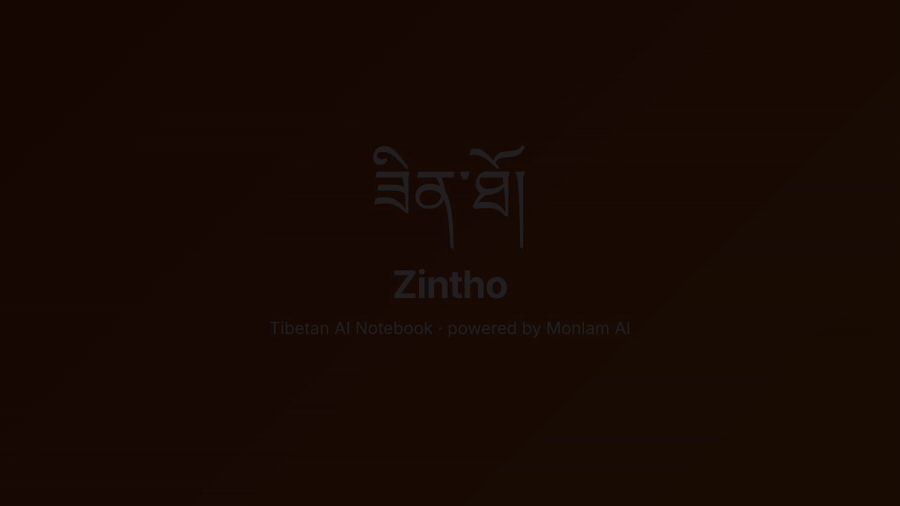

# ཟིན་ཐོ། Zintho: Tibetan AI Notebook

A NotebookLM-style study notebook for Tibetan, powered by Monlam AI.

**🌐 Try it live: [zintho.vercel.app](https://zintho.vercel.app/)**

<p align="center">
  <a href="demo/Zintho-demo.mp4"></a>
  <br>
  <sub>▶ <a href="demo/Zintho-demo.mp4">Watch the full demo video (1 min, MP4)</a></sub>
</p>

Add texts, scanned pechas or recorded teachings, then chat with them and turn them into summaries, study guides, glossaries, quizzes, mind maps, infographics, slide decks and Tibetan audio overviews.

## Features

### 📥 Add any kind of source
- **Paste text** in Tibetan or English, or upload `.txt` / `.md` files
- **PDFs**: the text layer is read directly, and **scanned pages are read with Monlam OCR**
- **Images** of pechas, books or notes → text with **Monlam OCR**
- **Audio**: upload recordings of teachings or lectures, or **record in the app**, transcribed with **Monlam speech-to-text**
- **From a topic**: no document? Melong writes a study document for you, clearly labelled *AI-generated*
- Tick or untick sources to choose which ones the AI uses

### 💬 Chat with your sources
- Answers come **only from your selected sources**, never from guesswork
- **Clickable citations** on every answer open the exact source it came from
- A **notebook overview** and **suggested questions** appear as soon as you add sources
- **Ask by voice**: speak your question and it's transcribed
- **Save** any answer as a note, copy it, or **read it aloud**

### 🎓 Studio: turn sources into study material
| Tool | What you get |
|---|---|
| 🎧 **Audio overview** | A two-host conversation about your sources, spoken with Tibetan voices, with a transcript that follows along |
| 📝 **Summary** | A short overview and the key points |
| 📖 **Study guide** | Key concepts, terms, short-answer and essay questions, with an answer key |
| 📚 **Glossary** | Important Tibetan terms with their meanings |
| ✅ **Quiz** | Multiple-choice questions with explanations and a score; retry anytime |
| 🧠 **Mind map** | The whole text as a tree; click any topic to ask about it in chat |
| 🖼️ **Infographic** | A one-page visual summary with key numbers, points and a timeline, **downloadable as PNG** |
| 📊 **Slide deck** | 7–10 slides with speaker notes; **present full screen**, or download as **PowerPoint** or **PDF** |

You can also write your own notes alongside the generated ones.

### 🔊 Listen in Tibetan
- **Read aloud** any answer, note or source with Monlam text-to-speech
- Six voices: **Lhasa, Amdo and Kham**, female and male
- Audio you've already played is saved in your browser, so replays are free

### 🏔️ Made for Tibetan
- Tibetan-first design with proper Tibetan fonts
- Switch AI answers between **བོད་ཡིག** and **English** with one click
- Infographics and slides use real Tibetan text, never garbled AI-drawn letters

### 🔒 Private and simple
- **Bring your own Monlam API key**: it's stored only in your browser
- Notebooks are saved **in your browser**, not on a server
- Works on desktop and phone, in light or dark mode
- No sign-up, and no install needed to use [zintho.vercel.app](https://zintho.vercel.app/)

## Get started: your Monlam API key

Zintho runs on the Monlam AI models, available through [Monlam AI Studio](https://monlamai.studio/). Each user brings their own key:

1. Sign in to [Monlam AI Studio](https://monlamai.studio/) and open **API keys** to create a key.
2. Open [zintho.vercel.app](https://zintho.vercel.app/), click **⚙ Settings** and paste the key.
3. Click **Save key**. Zintho tests the connection for you.

Your key is saved **only in your browser** and sent with your own requests to Monlam. It is never stored on the server. Without a key, Zintho runs in demo mode with sample answers.

| Feature | Monlam model |
|---|---|
| Chat, summaries, study guides, glossary, quiz, mind map, infographic and slide content | Melong (`melong-2.5`) |
| Scanned pages and images → text | Monlam OCR (`monlam-ocr`) |
| Audio and recordings → text | Monlam speech-to-text (`monlamai-stt`) |
| Read-aloud and audio overviews (Lhasa, Amdo and Kham voices) | Monlam text-to-speech (`monlamai-tts`) |

Monlam API reference: [api-v1.monlamai.studio/docs](https://api-v1.monlamai.studio/docs). Usage counts toward your own Monlam account's limits (for example, 1,000 requests per day).

## Run it on your computer

You need **Node.js 18 or newer** (https://nodejs.org). There's nothing else to install, because the app has no npm dependencies.

```bash
cd ~/Desktop/Zintho-Tibetan-AI-Notebook
npm start                 # open http://localhost:4747
```

On a Mac you can also double-click **start.command**.

**API key:** click **⚙ Settings** in the app and paste your Monlam key. It's saved only in your browser. Alternatively, put it in `.env` as `MONLAM_API_KEY=...` and it will be used whenever no key is set in the browser. With no key at all, the app runs in **demo mode** with sample answers.

## Connecting the Monlam API

Zintho uses the Monlam Studio API (full reference: https://api-v1.monlamai.studio/docs). Create a key under **API keys** in [Monlam AI Studio](https://monlamai.studio/), then paste it into **⚙ Settings** in the app.

| Feature | Request |
|---|---|
| Auth | header `X-API-Key: <your key>` |
| Chat | `POST /api/v1/ai/chat` with `{model_name, messages, max_tokens, temperature}` |
| Text-to-speech | `POST /api/v1/text-to-speech/stream` with `{text, voice_name, model_name}` → audio/wav |
| Speech-to-text | `POST /api/v1/speech-to-text/` (multipart `file`, `language=bo`, `task=transcribe`) |
| OCR | `POST /api/v1/ocr/single-page` (multipart `file`, `lang_hint=bo`) |

- Voices: `lhasa_female`, `lhasa_male`, `amdo_female`, `amdo_male`, `kham_female`, `kham_male`. `MONLAM_TTS_VOICE` sets the read-aloud voice and host 1 of the audio overview; `MONLAM_TTS_VOICE_B` sets host 2.
- `MONLAM_CHAT_MODEL` is `melong-2.5` (130,000-token context); `melong-2.8` also works.
- TTS speaks Tibetan, so set the language switch to བོད་ཡིག before generating an audio overview.
- `MAX_CONTEXT_CHARS` limits how much source text is sent per request.
- To tune the prompts, edit `server/prompts.js`. All API code is in `server/monlam.js`.

## Project layout

```
server.js            local web server (npm start)
api/[route].js       the same AI routes as a Vercel serverless function
server/handlers.js   AI routes shared by both (chat, generate, ocr, stt, tts, test)
server/monlam.js     Monlam API adapter (the only file that talks to Monlam)
server/prompts.js    prompts for chat and each Studio tool
server/demo.js       sample answers for demo mode
public/              the web app (index.html, styles.css, app.js, visuals.js)
public/vendor/       PptxGenJS 4.0.1 (MIT) for PowerPoint export
vercel.json          Vercel config
```

## Notes

- A key pasted in Settings is stored only in that browser's local storage and sent with each request. A key in `.env` stays on the server. Don't commit `.env`; it's already in `.gitignore`.
- The PDF reader (pdf.js) and fonts load from a CDN, so the browser needs an internet connection.
- Browser recordings are saved as `.webm` (Chrome) or `.m4a` (Safari). If Monlam STT rejects one format, try uploading a `.wav` or `.mp3` file instead.
